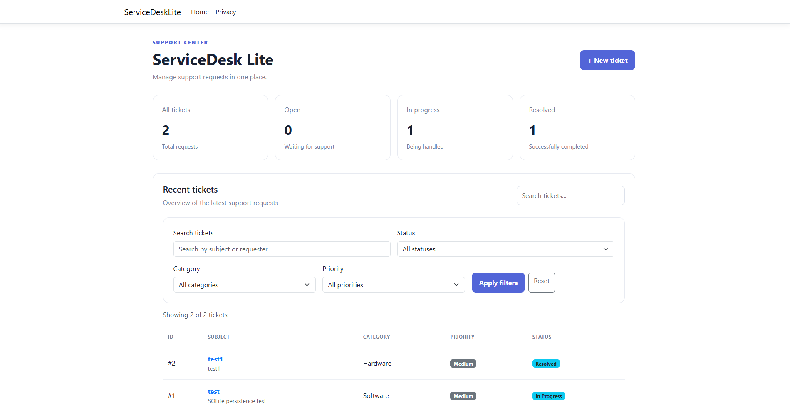
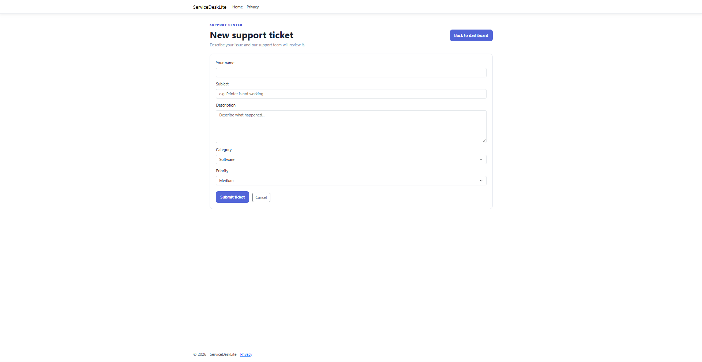
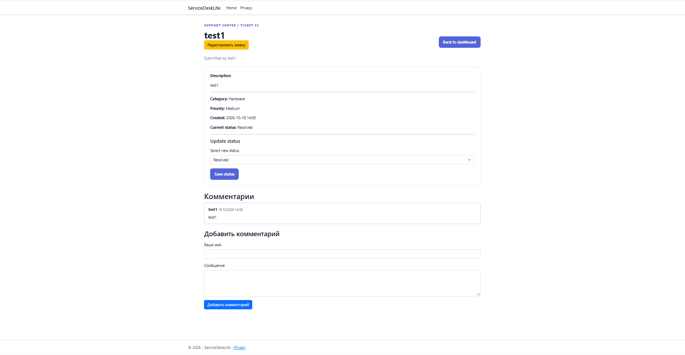
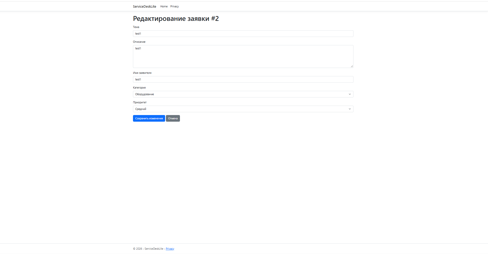
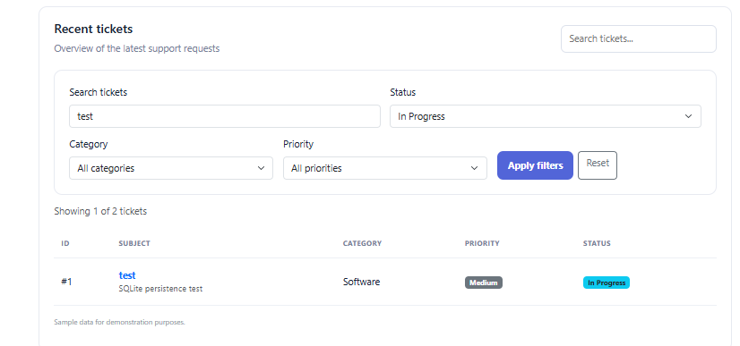

# ServiceDesk Lite

A lightweight IT support ticket management web application built with ASP.NET Core Razor Pages, C#, and SQLite.

ServiceDesk Lite allows users to create, track, search, filter, and update support tickets. It also supports ticket comments and editing existing tickets while preserving their status and comment history.

## Features

- **Ticket management** — create, view, and edit support tickets.
- **Search and filtering** — search tickets and filter them by status, category, and priority.
- **Status tracking** — track tickets as Open, In Progress, or Resolved.
- **Comments** — add comments to tickets and keep a persistent discussion history.
- **Ticket details** — view ticket information and its comments on a separate page.
- **Input validation** — required fields, length limits, and validation of ticket properties.
- **Persistent storage** — store tickets and comments in an SQLite database using Entity Framework Core.
- **Dashboard counters** — view the number of tickets in each status.


## Screenshots

### Dashboard
View ticket statistics, search requests, and filter them by status, category, and priority.



### Create a ticket
Submit a support request with a subject, description, requester name, category, and priority.



### Ticket details and comments
View ticket information, update its status, and add comments.



### Edit a ticket
Update ticket information while preserving its status and comment history.



### Search and filters
Find tickets using text search and filtering options.



[Русская версия README](README.ru.md)


## Technologies

- C#
- ASP.NET Core Razor Pages
- .NET 10
- Entity Framework Core
- SQLite
- HTML5
- CSS3
- Bootstrap
- Git and GitHub

## Getting Started

### Prerequisites

- [.NET 10 SDK](https://dotnet.microsoft.com/download/dotnet/10.0)
- A code editor, such as [Visual Studio Code](https://code.visualstudio.com/)

### Run locally

1. Clone the repository:

   ```bash
   git clone https://github.com/iseedeadpeople792/ServiceDeskLite.git
   ```

2. Open the project directory:

   ```bash
   cd ServiceDeskLite
   ```

3. Restore dependencies:

   ```bash
   dotnet restore
   ```

4. Apply database migrations:

   ```bash
   dotnet ef database update
   ```

   If the EF Core command-line tool is not installed, install it with:

   ```bash
   dotnet tool install --global dotnet-ef
   ```

5. Start the application:

   ```bash
   dotnet run
   ```

6. Open the local URL displayed in the terminal.

## Database

The application uses SQLite for persistent storage. Entity Framework Core manages database access and schema migrations.

The local database file is not included in the repository. Apply the migrations to create the database structure.

## Project Structure

- `Data/` — database context.
- `Migrations/` — Entity Framework Core migrations.
- `Models/` — ticket and comment models.
- `Pages/` — Razor Pages and user interface.
- `Services/` — ticket management and data access logic.
- `wwwroot/` — static assets, including CSS and JavaScript.
- `Program.cs` — application configuration and dependency injection.

## Project Status

This is an educational portfolio project created to practice C#, ASP.NET Core, database integration, and web application development.

The project demonstrates core ticket management functionality. It is not intended to be a production-ready IT service management platform.

## Author

Developed as a learning and portfolio project.

[GitHub Repository](https://github.com/iseedeadpeople792/ServiceDeskLite)
